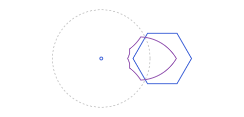

# Apollonius [](https://juliahub.com/ui/Packages/General/Apollonius) [](https://github.com/gxono/Apollonius.jl/actions/workflows/CI.yml?query=branch%3Amaster) [](https://gxono.github.io/Apollonius.jl/stable/) [](https://gxono.github.io/Apollonius.jl/dev/) [](https://codecov.io/gh/gxono/Apollonius.jl)

<p align="center">
  
</p>

A Julia toolkit for planar Euclidean geometry: points, segments, lines,
rays, circles, triangles, quadrilaterals, conics and circular arcs, plus
the constructions you build with them (midpoints, intersections,
projections, reflections, rotations, triangle centers...).

Every exported type is its own struct, prefixed `AP`, organized into a
real abstract type hierarchy instead of loose, unrelated structs. See the
[documentation](https://gxono.github.io/Apollonius.jl/dev/) for the full
type tree, the rationale behind it, and the complete function catalog
(vector algebra, predicates, constructions, tangency, triangle centers,
conics, affine maps, and the batch-transform macros).

Status: early, actively evolving. The core 2D constructions and the full
classical Apollonius tangency problem are covered; dozens of named
triangle centers are implemented, with plenty more in the literature
(Clark Kimberling's Encyclopedia of Triangle Centers alone catalogues
thousands).

AI assistance was used for part of this package: translating the
documentation, writing function docstrings, and extending some existing
methods. Every change was reviewed and tested by hand before merging.

## Examples

Triangle centers and constructions:

```julia
using Apollonius

a, b, c = APPoint(0.0, 0.0), APPoint(4.0, 0.0), APPoint(0.0, 3.0)
t = APTriangle(a, b, c)

centroid(t)        # center of mass
circumcircle(t)     # circle through a, b, c
incenter(t)         # center of the inscribed circle

l = APLine(a, b)
perpendicular_through(l, c)   # altitude from c
intersection(l, circumcircle(t))
```

Inversion of a hexagon through a circle:

```julia
circ = APCircle2(APPoint(0.0, 0.0), 1)
hexagon = APStraightNgon([polar_point_deg(0.6, a) for a in 0:60:330]) |> translate(APVector(1.25, 0))
invert(hexagon, circ)   # the hexagon's image under inversion in circ
```

<p align="center">
  
</p>
